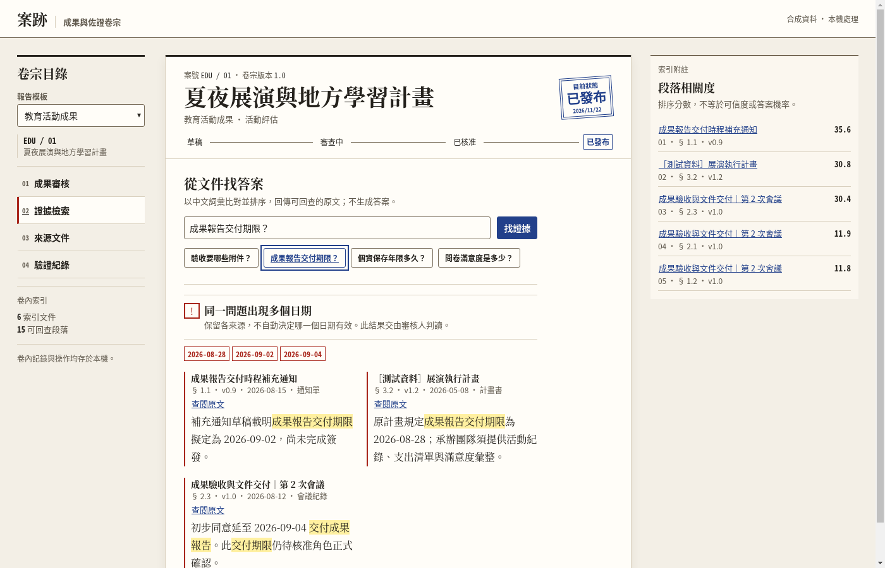
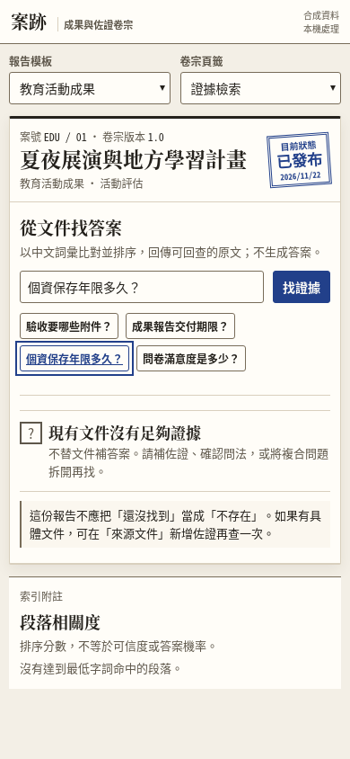

# 案跡｜機關成果填報與佐證審核方案

案跡把成果填報、退回補正、佐證查核及公開版預覽串成同一流程。承辦人依業務模板送件，審核人可回看文件原文並留下決定，發布人依欄位白名單確認公開內容。


畫面與測試使用合成資料。桌面拉開卷宗目錄、文件與頁邊批註之間的距離；手機維持單欄，補正理由排在表單前。[退回補正桌面畫面](assets/04-returned.png) · [390px 手機畫面](assets/03-mobile-gap.png) · [卷宗介面設計](DESIGN.md)

## 需求與交付範圍

| 需求 ID | 機關要解決的問題 | 展示交付 |
| --- | --- | --- |
| FR-01 | 不同業務須提供不同填報欄位 | 施政計畫／教育活動模板，欄位、必填、公開範圍及佐證集分開 |
| FR-02 | 填報、補正和核准須可追溯 | 送審、附理由退回、補正再送審、核准；保留狀態、示意角色、時間及意見 |
| FR-03 | 核准不等於公開，內外部資料要分流 | 核准後才能切到「已發布」示範狀態；公開版依白名單呈現，內部 JSON 另行匯出 |
| FR-04／05 | 文件說法要能回查，找不到或日期不一致時不應擅自判定 | 原文、段落、版本、日期、命中高亮；日期衝突並列，證據不足不生成答案 |
| IF-01 | 上游品管結果可作佐證，不複製原始資料 | 匯入彙總 JSON，驗證型別、合計、模板及欄位白名單，建立可搜尋的佐證段落 |

完整的[需求規格](docs/REQUIREMENTS.md)列明角色、資料流、配置點和正式導入責任；[驗證／驗收矩陣](docs/ACCEPTANCE.md)列明各需求的操作、預期結果及證據。正式版的 SSO、權限、受控發布、不可任意改寫的稽核與備援不在展示範圍。

| 日期不一致：並列原文，不擅自採用 | 證據不足：不補寫答案 |
| --- | --- |
|  |  |

## 實機操作與驗證

```sh
python3 -m http.server 8765 --bind 127.0.0.1
# 開啟 http://127.0.0.1:8765/
npm test
npm run evaluate
```

1. **填報到公開：**先送審，嘗試不填原因退回，再補寫原因、調整場次並重送。核准後切到發布預覽；比較公開版與內部 JSON。[退回畫面](assets/04-returned.png)
2. **審查佐證：**試查「驗收要哪些附件？」「成果報告交付期限？」「個資保存年限多久？」；開啟來源檢查段落、版本及日期。
3. **整合與配置：**切換施政模板，從來源文件匯入[合流](https://github.com/JWJProjects/public-data-quality-ai)的[合成品管彙總](examples/qa-evidence.json)，搜尋「資料品質檢查」。[介面契約](INTEGRATION.md)｜[實機匯入](assets/06-integrated.png)

**展示驗證：**8 項單元測試、22 個實機步驟；合成集 12/12 狀態判定、9/9 有標註題的必要原文皆在前三。[評估畫面](assets/05-evaluation.png)。測試採用固定的小型資料集。檢索為本機 BM25 與規則，無生成式模型，分數不等於可信度。

[流程設計參考](docs/REQUIREMENTS.md#4-設計參考)整理公開的填報、審查與成果彙整作業。
