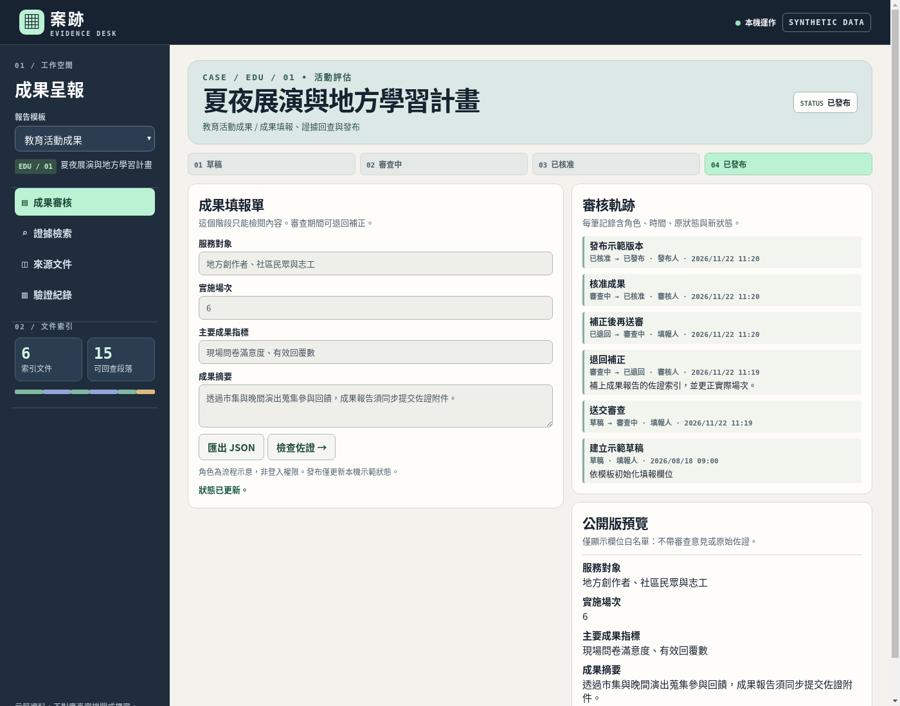

# 案跡｜公共成果填報與證據工作台

填報人依模板交件，審核人可要求補正或核准；發布前可查找佐證，逐段回看原文，發布後預覽只呈現允許公開的欄位。**這是可執行的自製作品，機關、專案、資料均為虛構，非政府委託或驗收實績。**



| 查詢遇到日期衝突 | 手機：證據不足時不填答案 |
| --- | --- |
|  |  |

## 兩分鐘實機演示

```sh
python3 -m http.server 8765 --bind 127.0.0.1
# 開啟 http://127.0.0.1:8765/
```

1. **補正與追溯**：送交審查 → 留下原因再退回 → 修改場次 → 補正後再送審。重整可回復已儲存的值。[退回時畫面](assets/04-returned.png)
2. **查找證據**：查「驗收要哪些附件？」查看具段落、版本與日期的原文；試「成果報告交付期限？」看並存日期，再試「個資保存年限多久？」看證據不足時的處理。
3. **核准與公開**：核准 → 發布示範版本。檢閱欄位白名單形成的公開版；匯出 JSON 是內部交接材料，保留完整欄位、佐證補充與狀態紀錄，不適合直接公開。
4. **切換情境**：左側換成「施政計畫成果」；主責單位、期別、工程成果取代教育活動欄位，並改用獨立文件集、草稿與公開白名單。也可於草稿或補正時貼上合成原文。
5. **跨系統交接**：在施政模板匯入另一個工作台[「合流」](https://github.com/JWJProjects/public-data-quality-ai)匯出的[品管彙總](examples/qa-evidence.json)，搜尋「資料品質檢查」可回查總筆數與各項結果。[實際匯入後畫面](assets/06-integrated.png)

## 配置、整合與交付邊界

| 機關可能要調整的項目 | 本版可演示 | 正式導入要對接 |
| --- | --- | --- |
| 填報規格、公開範圍 | `workflow.js` 的欄位、必填、公開白名單與範例資料 | 機關代碼、欄位字典、受限資料規則 |
| 作業節點、查核 | 狀態轉換表、補正原因、模擬角色、時間與 JSON 軌跡 | SSO、角色權限、不可竄改稽核、備份與復原 |
| 上游資料 | 貼上文字佐證；[品管彙總 JSON 介面](INTEGRATION.md) | 文件儲存、PDF/OCR、實場資料與交換 API |
| 證據判讀 | 中文單／雙字詞 BM25、規則增權、原文、高亮、日期衝突與不足分流 | 以機關的去識別資料重建驗證集；按正式文件效力和情境人工確認 |

可交接的內容：原始碼、兩組合成模板、使用與測試指令、JSON 介面，以及實際截圖。**本版無伺服器帳號、外部 API 或生成式模型**。檢索分數不代表可信度；相近問法可能漏找或誤找，日期檢查只覆蓋已檢出的格式，不會裁決文件效力。資料存放在瀏覽器，不能當正式文件庫。

## 驗證

```sh
npm test                     # Node 20+，無 npm 套件需安裝
npm run evaluate             # 逐題輸出狀態與必要證據
python tests/browser_smoke.py --capture  # 選用 Playwright + Chromium
```

合成教育活動測試：**12/12 狀態判定、9/9 題必要引用皆在前三**。這是手工小樣本，不是泛化準確率。[實機測試紀錄畫面](assets/05-evaluation.png)。另以 Qt WebEngine 在本機實跑 **22 個瀏覽器步驟**，包括退回必填、重整、公開版與下載內容、原文回查、衝突與不作答、切換模板及匯入另一工作台實際輸出的合成彙總。上列 PNG 即從該瀏覽器擷取。

呈現方式參考公開的 [原民會評選資料](https://www.cip.gov.tw/data/bid/202604/T-25631375.pdf?c=1F3AF1A79C1A38425E85BF3C0BF38120&fn=6E2132260E059F3FEF3398801A45C73C&s=C0DAF6E2A93658F9) 與 [林試所審查須知](https://www.tfrin.gov.tw/redirect_files.php?file_name=APlNxDCEL605wNc2DoWGEqualFWYKWcdnr1delQpQQz8XNl9ex&id=65728)，以使用情境、整合邊界和可重跑驗證說明能力；不代表符合任何特定標案。
